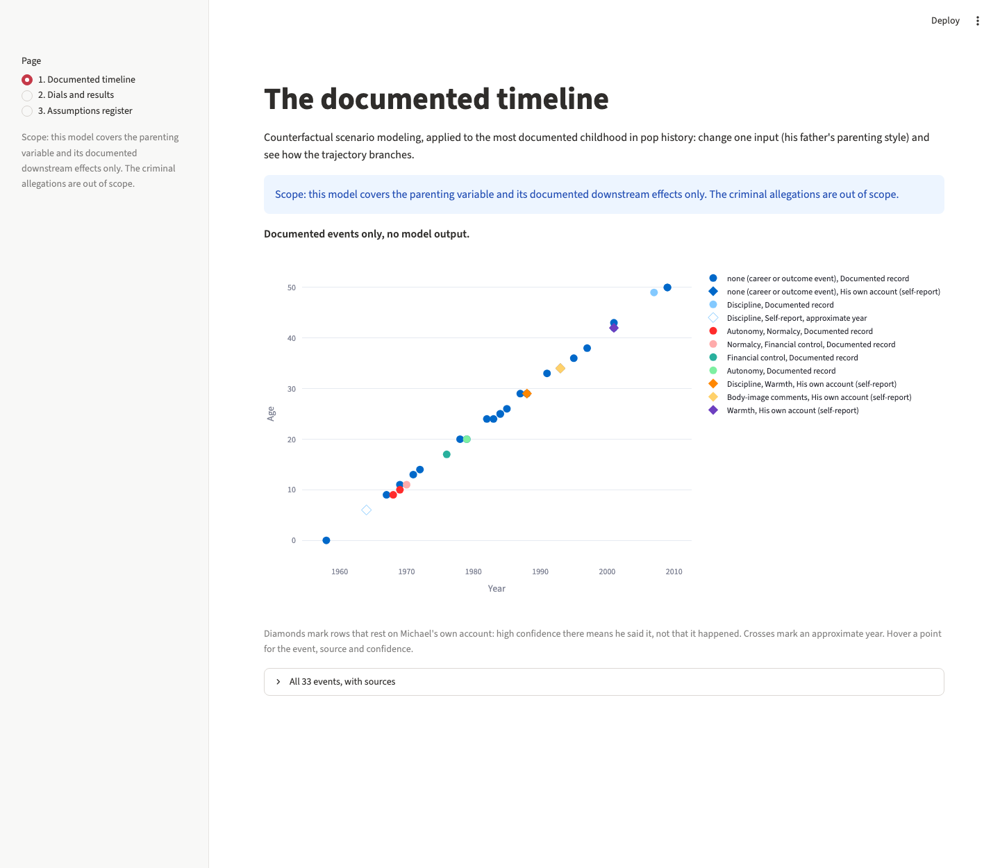
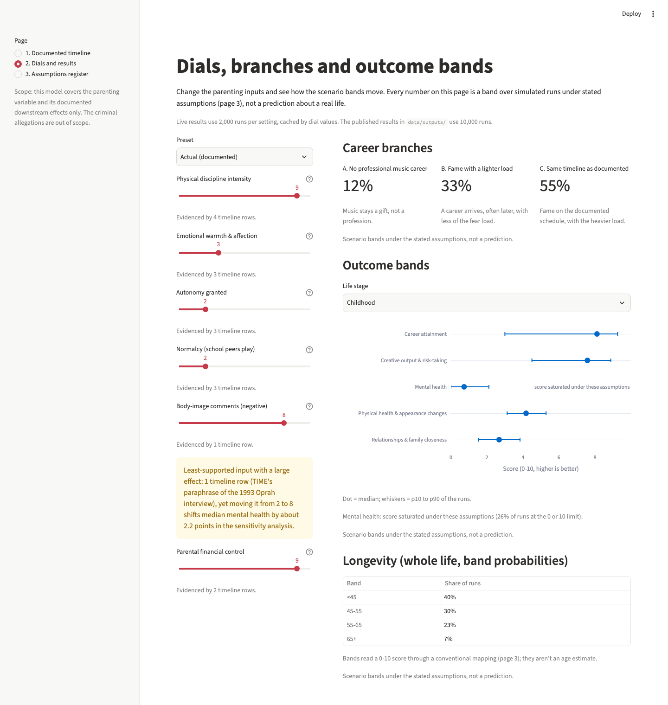
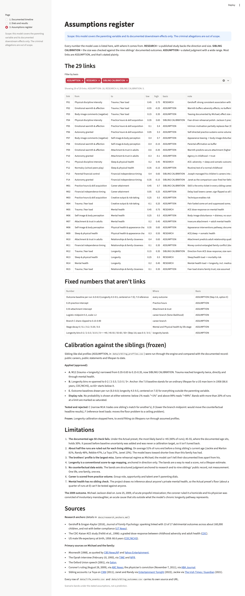

# Counterfactual: The Jackson Trajectory

Counterfactual scenario modeling, applied to the most documented childhood in pop history. The model changes one input in Michael Jackson's documented life, his father's parenting style, and maps how the trajectory branches.

**What this is:** a Monte Carlo scenario model. Every output is a band over 10,000 simulated runs, and each band rests on assumptions you can read on dashboard page 3 or in `data/parameters.csv`.

**What it isn't:** a prediction about an alternate life, or a judgment about how he died.

**Scope:** the model covers the parenting variable and its documented downstream effects only. The criminal allegations are out of scope.

## Method

1. **Six parenting dials** (0-10): physical discipline, warmth, autonomy, normalcy, body-image comments, financial control. The Actual preset is set from the documented record; two counterfactual presets lower the harsh dials.
2. **Six mediators** come from the dials: practice hours, trauma / fear load, self-image, attachment, sleep and health, and financial independence timing.
3. **A career branch.** Practice and trauma split each run three ways: A, no professional career; B, later fame with a lighter load; C, the documented timeline with the heavier load.
4. **Six outcomes**, scored 0-10 at five life stages: career, creative output, mental health, physical health, relationships, longevity. Longevity is reported only as band probabilities (<45 / 45-55 / 55-65 / 65+), never as a single age.
5. **29 links** connect dials to mediators to outcomes. Each one has a low/high range and a basis label: **RESEARCH** (6, a published study), **SIBLING CALIBRATION** (5, checked against the siblings) or **ASSUMPTION** (18, a stated judgment with a wide range). Most links are assumptions, and the model says so.
6. **Monte Carlo.** Each run draws every coefficient from its range, plus a baseline for each outcome that stands for everything outside the parenting variable. Seed 42, 10,000 runs per preset.

The full map is in [docs/mechanism_map.md](docs/mechanism_map.md). The research behind the RESEARCH links is in [docs/research_anchors.md](docs/research_anchors.md).

## The control group

Nine children grew up in the same house with the same father, and their exposure varied. Michael was lead singer from childhood. Rebbie and La Toya weren't in the group. Randy joined later. Janet was the youngest, and her father managed her until she was 19.

Their public views of Joseph vary. Jackie has said "My father was the one who cracked the whip"; Janet has said her father "drove me to be the best that I can"; and Michael told the Oxford Union in 2001, "He pushed me because he loved me." Their public record (careers, their own statements about Joseph, lifespan to date) is in `data/sibling_outcomes.csv`. Eight sibling-like dial profiles (all ASSUMPTION) were run through the model. Two ranges and the longevity mapping were changed as a result, and then calibration was frozen. The full write-up is in [docs/calibration_notes.md](docs/calibration_notes.md).

## Findings (bands under the stated assumptions)

**1. The discipline trade-off.** Keep the Actual preset's other dials and lower discipline alone. The share of runs with no professional career rises sharply:

| Discipline | 9 (Actual) | 7 | 5 | 3 | 2 |
|---|---|---|---|---|---|
| A: no professional career | 12% | 22% | 38% | 58% | 68% |

This rests on three assumptions:
- fear-driven practice is a strong path to skill (P04, 0.35-0.65)
- fame likelihood crosses 50% at a practice level of 5.5 (the logistic midpoint)
- career is scored on practice volume only, not on talent, opportunity or group role

Change any of them and this finding moves.

**2. The interaction.** The same low discipline doesn't have to end the career. In the "Firm but nurturing" preset (discipline 2, with warmth and autonomy raised), the no-career share is 29%, not 68%. That's because warmth and autonomy hold practice up: intrinsic motivation replacing fear. Both of those links are ASSUMPTION (P05, P06), so read this as a mechanism the model allows, not one it measured.

| Preset | A: no career | B: later fame, lighter load | C: documented timeline | Mental health, Childhood (median, p10-p90) |
|---|---|---|---|---|
| Actual (documented) | 12% | 33% | 55% | 0.8 (0.0-2.2) |
| Strict coach, warm father | 21% | 64% | 15% | 5.2 (4.2-6.2) |
| Firm but nurturing | 29% | 61% | 11% | 6.8 (6.0-7.7) |

**3. No single "most important dial."** One-at-a-time sensitivity (Actual preset, each dial moved from 2 to 8, 10,000 runs per side):
- **Discipline** leads career (+4.7 points), creative output and longevity (the 65+ share falls by 43 percentage points).
- **Warmth** leads mental health (+3.0) and relationships (+2.0).
- **Body-image comments** lead physical health (−1.7) and nearly match discipline on mental health (−2.2). They're also the least-supported input: one timeline row.

The published table is `data/outputs/sensitivity_actual.csv`.

## Limitations

- **The documented age-50 check fails.** Under the Actual preset the most likely band is <45 (40%). 45-55, where his documented age sits, holds 30%. It was never a calibration target, so it wasn't tuned back.
- **About half the runs are ruled out for each living sibling.** On average 51% of runs end before a living sibling's current age. The model leans toward shorter lives than this family has had.
- **The brothers' profile is the largest miss.** Jackie, Tito and Marlon went through the same rehearsal regime as Michael, and the model can't tell their documented lives apart from his.
- **Actual's mental health sits on a floor.** About a quarter of runs score exactly 0, and the dashboard marks that band as saturated. No sibling check is possible: the project draws no inference about anyone's private mental health.
- **Longevity is a conventional score-to-age mapping.** It's anchored in direction only: 7.0 stands for an ordinary lifespan for a US man born in 1958 (66.6 years, CDC/NCHS). It isn't a lifespan estimate.
- **Career can't be ranked the way the record does.** Practice volume isn't talent, opportunity or group role.
- **Calibration is frozen.** It stopped after one pass, to avoid fitting six lifespans run through profiles that are themselves guesses.
- **No counterfactual data exists for anyone.** These bands are structured judgment anchored to research and to nine siblings' public record. One life, one family, one era.

**The 2009 outcome.** Michael Jackson died on June 25, 2009, of acute propofol intoxication. The coroner ruled it a homicide, and his physician was convicted of involuntary manslaughter. That's an acute cause outside what the model's chronic longevity pathway represents.

## How to run it

```bash
git clone https://github.com/rajisworking16/jackson-counterfactual.git
cd jackson-counterfactual
python3 -m venv .venv && source .venv/bin/activate
pip install -r requirements.txt
python model/simulate.py              # seeded, 10,000 runs; writes data/outputs/
streamlit run app/streamlit_app.py    # the dashboard; ?page=2 opens a page directly
pip install -r requirements-dev.txt
python -m pytest tests/               # 16 dashboard tests
```

The dashboard runs the engine live at 2,000 runs per setting. The published results in `data/outputs/` use 10,000.

## How it was built

Python, pandas and NumPy for the model; Streamlit and Plotly for the dashboard; plain CSVs for every dataset. Each engine function was tried first in `notebooks/03_engine_sandbox.ipynb`, with its output predicted by hand, and then moved into `model/simulate.py`.

The implementation was AI-assisted, using Claude Code. The design, the scope, the ground rules and every calibration decision were mine: which changes to apply, which to reject, and when to freeze. The commit history and `docs/calibration_notes.md` record each decision and the reason for it.

## Sources

**About Michael and the family.** His own words: *Moonwalk* (1988), the Oprah interview (February 10, 1993), the Oxford Union speech (2001). Also court and coroner records (the August 2009 ruling, the November 2011 conviction) and the siblings' own public statements. Every row of `data/life_events.csv` (33 events) and `data/sibling_outcomes.csv` carries its source and URL.

**Research:**
- Gershoff & Grogan-Kaylor (2016), *Journal of Family Psychology*, on spanking and child outcomes.
- Felitti et al. (1998) and the CDC-Kaiser ACE study, on childhood adversity and adult health.
- CDC/NCHS life expectancy tables.

Details are in [docs/research_anchors.md](docs/research_anchors.md).

## Screenshots

Page 1, the documented timeline (documented events only, no model output):



Page 2, dials, career branches and outcome bands:



Page 3, the assumptions register:


