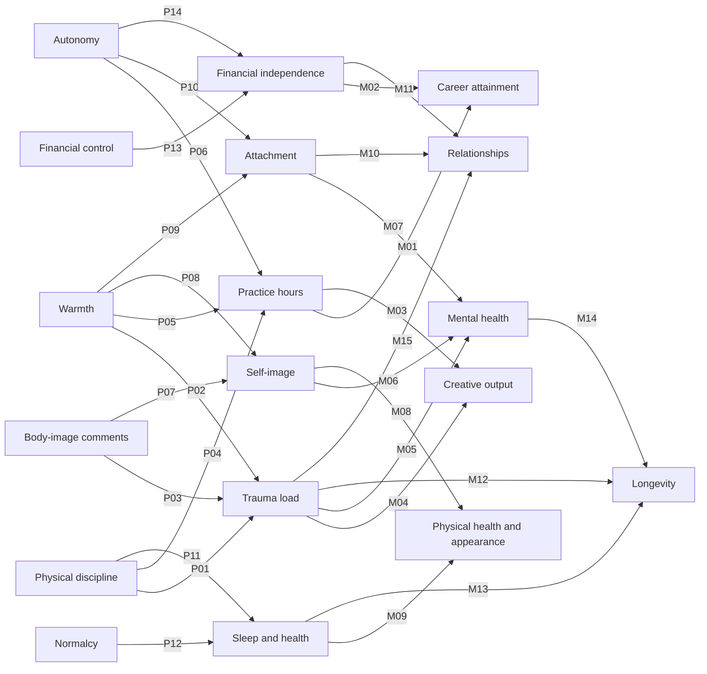

# Counterfactual: The Jackson Trajectory - COMPLETE BUILD GUIDE
### Setup → build → ship, step by step, with a git commit at every step

**Owner:** Sai Pranav Raj Kandula · **Repo:** `jackson-counterfactual` (GitHub: `rajisworking16/jackson-counterfactual`)
**Stack:** Python (pandas, NumPy) · Streamlit · Plotly · CSV datasets
**Last updated:** 2026-11-19 (Central) · **Where you are:** Phase 1, Step 1.1 (6 of 12 spine rows sourced)
**Local folder:** `~/projects/jackson-counterfactual` (Mac, VS Code) · **Branch:** `main`
**How to use this file:** Work top to bottom. Every numbered step ends with an exact `git add` + `git commit` - run them in order and the repo history tells the whole build story. Do not skip the verification box at the end of each phase.
**Working in Claude Code:** `CLAUDE.md` in the repo root carries the ground rules, current status and working limits, and Claude Code loads it automatically, so there's nothing to paste. This guide lives at `docs/BUILD_GUIDE.md`. Start a session with: "Read docs/BUILD_GUIDE.md and do the next step in CURRENT STATUS." Claude Code does one step, shows the diff, and stops before committing.
**Working in a claude.ai chat instead:** paste the Master Prompt (Step 0.2) at the start.

---

## CURRENT STATUS (as of 2026-11-20)

| Phase | Status |
|---|---|
| 0. Setup | ✅ Done |
| 1. Research dossier | ✅ Done (33 events, 9 siblings, anchors doc) |
| 2. Data model | ✅ Done (life stages, 29 parameters, mechanism map, review fixes) |
| 3. Simulation engine | ✅ Done. Engine seeded at 10,000 runs; calibrated against siblings (M12 narrowed, longevity bins re-spanned, display rule). Actual puts 63% of runs in 45-55 (documented age 50) |
| 4. Dashboard | ⬜ Not started |
| 5. Write-up + ship | ⬜ Not started |

**Commits (newest first):**
```
Phase 3: sibling calibration pass - notes + parameter adjustments   (this commit)
c066725 Phase 3: Monte Carlo runner (10k runs, seeded) + sensitivity + first results
0ac8f63 Phase 3: outcome scoring per life stage (6 dimensions, stage decay)
efdb998 Phase 3: career branch node (A/B/C) with discipline-warmth interaction
0780166 Phase 3: mediator computation from dials (6 mediators, clipped 0-10)
96cf388 Phase 3: engine skeleton - presets, seeded RNG, parameter sampler
e41aff2 Phase 2: record conflicting Michael self-direction dates
1c6851b Phase 2: fix M02 sign, P14 basis, dial and mediator text
7cc3f59 Phase 2: mechanism map (dials -> mediators -> outcomes) + sign convention
ad3ff4e Phase 2: parameters table - 29 links with ranges and basis labels
8ad5a33 Phase 2: life stages table for outcome scoring
227dc15 Update CURRENT STATUS after Phase 1 review fixes
6528744 Phase 1: review fixes - dates, body-image evidence, sibling markers
aeb161b Phase 1: research anchors doc (Gershoff, ACE, child-performer literature, sibling method)
3fb2c34 Phase 1: sibling control group filled (9 siblings, sourced)
e388b6f Phase 1: extend timeline batch 2 (verified events to 30-40 rows)
4c6cad9 Phase 1: extend timeline batch 1 (verified events to ~20 rows)
e5a8a6c Phase 1: spine complete - 12 rows sourced
a2fdac8 Phase 1: add self_report flag, split dial_links / outcome_links
c15dbf3 Phase 1: source 1979, 1984, 1993 rows
6979ea9 Add CLAUDE.md and build guide for Claude Code sessions
c08a288 Phase 1: fix audition/signing/#1 dates, first 3 rows sourced
3b1af32 Phase 0: project scaffold - data schemas, starter datasets, notebooks
```

**Decisions made:**
- 2026-11-19: `self_report`, `dial_links` / `outcome_links` split, `url` column. The age-check cell is Pranav's.
- 2026-11-20:
  - `year_approx` column.
  - M15 added (ASSUMPTION), so the table has 29 rows.
  - Six links relabeled RESEARCH -> ASSUMPTION.
  - M02 range flipped to 0.05-0.25 (subtraction kept).
  - Michael's self-direction recorded as 20-25 (1979 or 1983; sources conflict).
  - Jermaine marked `use_in_calibration = no (proxy)`.

**Open:**
- Jermaine's 2011 memoir hasn't been read.
- Janet's split date: WDET says 1985; ET 2022 places it before her second album.

**Next step:** STOP at phase boundary. Pranav reviews docs/calibration_notes.md, then Phase 4 (Step 4.1, dashboard page 1).

**Hard stops still ahead:** Step 5.2 (real readers). The v1.0 tag and repo visibility are Pranav's.

**Every session starts with** (in Claude Code, CLAUDE.md tells it to run these checks itself):
```bash
cd ~/projects/jackson-counterfactual
source .venv/bin/activate
git status
```

---

## GROUND RULES - never break these (they are the project's credibility)

1. **Not a prediction.** The model outputs probability bands over scenarios, each labeled with its assumptions. Any sentence that claims certainty about an alternate life gets rewritten as a banded scenario.
2. **Source everything about Michael from his own words and the documented record** - his autobiography *Moonwalk*, his interviews, court records, sibling accounts. Never invent trauma details or private facts.
3. **Joseph stays three-dimensional.** The model holds both truths: the harshness caused documented harm AND was entangled with the discipline that made the Jackson 5. No cartoon villain.
4. **The criminal allegations are OUT OF SCOPE.** The model covers the parenting variable and its documented downstream effects only. State that scope wherever the model's limits are described (README, dashboard page 3).
5. **No death gamification.** His 2009 death is a documented outcome at the end of the real timeline - handled soberly, never a score, countdown, or slider.
6. **Every parameter range carries a basis label:** RESEARCH (published study) / SIBLING CALIBRATION (the nine siblings' outcomes) / ASSUMPTION (wide range, stated plainly). No silent numbers.

---

# PART 0 - SETUP

## Step 0.1 - Get the repo onto your machine ✅ DONE (2026-11-18)

Done on the Mac at `~/projects/jackson-counterfactual` (next to the other portfolio repos), opened in VS Code. `setup_mac.sh` created the venv, installed the libraries, registered the Jupyter kernel, wrote the VS Code settings and made the first commit on `main`. The repo was pushed with `gh repo create jackson-counterfactual --public --source=. --remote=origin --push`.

Note: the scaffold commits Muse made in its own workspace (`8b5554c`, `72565b8`) are not in this repo. Your repo was built fresh from the same starter data, so GitHub's history starts at `3b1af32`.

Actual structure:

```
jackson-counterfactual/
├── CLAUDE.md                  (Claude Code rules + working limits)
├── SETUP.md                   (setup guide)
├── setup_mac.sh               (one-time Mac setup: venv, kernel, VS Code settings, first commit)
├── requirements.txt           (pandas, numpy, streamlit, plotly, ipykernel)
├── .gitignore                 (includes .venv/, .ipynb_checkpoints/)
├── .vscode/                   (created by setup_mac.sh; points VS Code at .venv)
├── data/
│   ├── dials.csv              (6 dials, filled)
│   ├── life_events.csv        (12 spine events; 6 sourced locally, 3 of those pushed)
│   ├── mediators.csv          (6 mediators, filled)
│   ├── outcome_dimensions.csv (6 dimensions, filled)
│   └── sibling_outcomes.csv   (9 siblings; detail columns EMPTY, Step 1.3 fills them)
├── notebooks/
│   ├── 00_setup_check.ipynb   (venv, libraries, loads every CSV)
│   ├── 01_research_dossier.ipynb (shows rows missing a source; age-check cell is yours to write)
│   ├── 02_data_model.ipynb    (loads dials/mediators/outcomes/siblings; link-table draft space)
│   └── 03_engine_sandbox.ipynb (seed 42, predict-first template for Phase 3)
├── model/                     (empty, Phase 3)
├── app/                       (empty, Phase 4)
└── docs/
    └── BUILD_GUIDE.md         (this file)
```

There is no README.md yet. Step 5.1 creates it.

**Workflow per phase:** edit the CSV or draft code, re-run that phase's notebook to check it, commit, push. Functions get tried in `03_engine_sandbox` first, then move into `model/simulate.py`.

## Step 0.2 - Start every claude.ai chat session with the Master Prompt

(Not needed in Claude Code: `CLAUDE.md` covers it.)

```
You are my senior data analyst mentor and pair-programmer. I am a Business
Analytics & AI master's student building a portfolio project, and I want to
LEARN while I build - explain the "why" behind each step in 2-3 lines before
giving me code, and let me write the code first where I can; review it after.

PROJECT: "Counterfactual: The Jackson Trajectory" - a scenario model that
changes ONE input in Michael Jackson's documented life (his father Joseph's
parenting style: harsh/fear-based -> firm but nurturing) and simulates how
his life trajectory branches.

RULES OF THE MODEL - never break these:
1. NOT a prediction. Outputs are probability bands over scenarios, every one
   labeled with its assumptions. If I write text that claims certainty about
   an alternate life, flag it and rewrite it as a banded scenario.
2. Source everything about Michael from his OWN words and the documented
   record (his autobiography Moonwalk, his interviews, court records,
   sibling accounts). Never invent trauma details or private facts.
3. Joseph stays three-dimensional: the model must hold both truths - the
   harshness caused documented harm AND was entangled with the discipline
   that made the Jackson 5. No cartoon villain.
4. The criminal allegations are OUT OF SCOPE. The model covers the parenting
   variable and its documented downstream effects only. State that scope
   wherever the model's limits are described.
5. No death gamification. His death is a documented outcome at the end of
   the real timeline, handled soberly, never a score, countdown, or slider.
6. Parameter ranges come from (a) published developmental research on harsh
   discipline and adverse childhood experiences, and (b) calibration against
   the nine Jackson siblings' actual outcomes - same household, same father,
   varying exposure. If a parameter has neither source, mark it ASSUMPTION
   and give it a wide range.

STACK: Python, pandas, NumPy for the model; Streamlit + Plotly for the
interactive dashboard. Keep every dataset as a clean CSV I can show an
interviewer. Work in small steps: one function, one chart, one page at a
time, with a "what you just learned" note at the end of each step.
```

✅ **Phase 0 verification: PASSED (2026-11-18).** Phase 0 commit on GitHub on `main` · libraries import OK · `00_setup_check` runs on the .venv kernel.

---

# PART 1 - PHASE 1: THE RESEARCH DOSSIER

**Goal:** `life_events.csv` grows from 12 spine rows to 30–40 verified events, every row with a real source and a confidence rating; `sibling_outcomes.csv` filled for all 9 siblings; a research anchors doc written.
**Session prompt:** "Help me build the research dossier: a table of Michael's documented life events (year, age, event, which parenting dial it connects to, source). Start with the 15 most load-bearing events. I will verify each one against a source before we keep it."
**Confidence scale:** High = his own words or court/official record · Medium = credible biography or sibling account · Low = widely repeated but thinly sourced (avoid Low; if a row can only be Low, drop the row).
**Caveat on "his own words = High":** that rates how sure we are he *said* it, not whether it happened. See open decision 1 (`self_report` flag) in Current Status.

## Step 1.1 - Verify the spine rows in life_events.csv ✅ DONE (12 of 12, 2026-11-19)

The original 11 rows became 12. Three starter rows had wrong years or ages: the audition was July 23, 1968 (age 9, in Detroit), the Motown signing and LA move was March 11, 1969, and "I Want You Back" hit #1 on January 31, 1970. The 1968 and 1969 rows were replaced by three correct ones.

| Year | Age | Event (short) | Status | Source used / where to verify |
|---|---|---|---|---|
| 1958 | 0 | Born Aug 29, Gary, Indiana | ✅ Sourced | Public record / *Moonwalk* |
| 1964 | 6 | Jackson 5 formed; fear-based rehearsal regime | ✅ Sourced · Medium (early 1960s; exact year not in sources) | *Moonwalk*; sibling accounts. Core claim of the model and mostly his own account, so it's a likely `self_report = yes` |
| 1968 | 9 | Motown audition, Detroit, July 1968 (the Detroit page gives month only) | ✅ Pushed · High | Detroit Historical Society, Encyclopedia of Detroit: Jackson 5 |
| 1969 | 10 | Signs with Motown Mar 11; brothers to LA | ✅ Pushed · High | Detroit Historical Society, Encyclopedia of Detroit: Jackson 5 |
| 1970 | 11 | "I Want You Back" #1 Billboard Hot 100, Jan 31 | ✅ Pushed · High | Motown Classic: Jackson 5 *I Want You Back* |
| 1978 | 20 | *The Wiz*; meets Quincy Jones | ✅ Sourced | Film record; both men's accounts |
| 1979 | 20 | *Off the Wall* released Aug 10 (age fixed from 21) | ✅ Pushed · High | AllMusic: *Off the Wall* |
| 1982 | 24 | *Thriller* | ✅ Sourced | Chart/sales records |
| 1984 | 25 | Pepsi scalp burn, Jan 27; widely reported as start of painkiller use | ✅ Pushed · Medium | Biography.com. Medium because the painkiller link is reported, not proven. Wording changed from "documented start" |
| 1988 | 29 | *Moonwalk* publishes his account; buys Neverland | ✅ Sourced | The book itself; property records |
| 1993 | 34 | Oprah interview, Feb 10 | ✅ Pushed · High | Oprah.com: Oprah Reflects on Her Interview with Michael Jackson. High = he said it; Joseph denied the beatings |
| 2009 | 50 | Dies June 25, 2009 (propofol; physician convicted) | ✅ Sourced | Coroner's report; court record of the trial |

```bash
# done: c08a288
git commit -m "Phase 1: fix audition/signing/#1 dates, first 3 rows sourced"
# done:
git add data/life_events.csv
git commit -m "Phase 1: source 1979, 1984, 1993 rows"
# after open decisions 1 and 2:
git add data/life_events.csv
git commit -m "Phase 1: add self_report flag, split dial_links / outcome_links"
# after the last 6 rows:
git add data/life_events.csv notebooks/01_research_dossier.ipynb
git commit -m "Phase 1: spine complete - 12 rows sourced, age check added"
```

## Step 1.2 - Extend the timeline to 30–40 events ✅ DONE (31 rows, 2026-11-19)

Add rows in small batches (5–8 at a time), verifying each before it stays. Candidate documented events to research (verify each; drop any you cannot source):

- 1962–63: Joseph forms the earliest version of the group with Jackie, Tito, Jermaine
(1968 audition, 1969 signing/LA move and 1970 #1 are already in the spine, so skip them here.)

- 1966: Group wins Apollo Theater amateur night (documented in multiple accounts)
- 1967: First recordings at Steeltown Records
- 1971: Solo career begins ("Got to Be There"); still touring with brothers
- 1972: "Ben" - #1 solo hit at 14, a song about a rat; his loneliness comments in interviews
- 1973–75: Voice changes; Motown restricts creative control; family conflict over direction
- 1975: Family leaves Motown for CBS/Epic (The Jacksons); Joseph's management role contested
- 1979–80: *Off the Wall* Grammy snub reaction - documented drive ("I'll show them") in his notes/interviews
- 1983: *Motown 25* moonwalk performance; *Billie Jean*/*Beat It* era
- 1984: Victory Tour - family friction documented; last tour with brothers
- 1987: *Bad* era; appearance changes become public discussion (his later explanations)
- 1988: Fires his father as manager (documented management split) - Financial control / Autonomy dials
- 1991: *Dangerous*; "Black or White"
- 1993: First public detailed statements about his childhood (Oprah) - already in spine; add the Grammy Legend Award speech remarks about childhood if sourced
- 1995: *HIStory*; "They Don't Care About Us" era workload/health reports - only if well sourced
- 2001: *Invincible*; Oxford Union speech (March 2001) - he speaks at length about his father, forgiveness, and childhood. **This is a primary-source goldmine for the dials - verify quotes from the speech text.**
- 2002: Birth of his third child; family life period (keep factual, minimal)
- 2005: Trial and acquittal - the model's scope note: record ONLY as a life event marker if needed for the timeline; the allegations themselves stay out of scope (Rule 4). Safer: omit this row entirely.
- 2009: "This Is It" comeback rehearsals underway at death (documented)

Keep `dial_links` honest: a row links only to dials the event genuinely evidences.

```bash
git add data/life_events.csv
git commit -m "Phase 1: extend timeline batch 1 (verified events to ~20 rows)"
git add data/life_events.csv
git commit -m "Phase 1: extend timeline batch 2 (verified events to 30-40 rows)"
```

## Step 1.3 - Fill the sibling control group ✅ DONE (2026-11-19)

For each of the 9 rows in `sibling_outcomes.csv`, fill `career_path`, `public_wellbeing_markers`, and `source`. Keep every entry to documented public record: careers (solo/group success, longevity in the industry), public statements about Joseph and their childhood (several siblings have spoken on the record - use their own words where possible), and broad public-life markers. No speculation about private mental health. The analytical point: exposure varied (Rebbie left earliest; Janet got a later-era Joseph and self-steered from 18; Michael had maximum exposure as lead singer and focal point) - that spread is what calibrates the model in Phase 3.

```bash
git add data/sibling_outcomes.csv
git commit -m "Phase 1: sibling control group filled (9 siblings, sourced)"
```

## Step 1.4 - Write the research anchors doc ✅ DONE (2026-11-19)

Create `docs/research_anchors.md` with one section per anchor, each ending with "Used for: <which model links>":

1. **Gershoff (2002) & Gershoff & Grogan-Kaylor (2016)** - meta-analyses on corporal punishment: consistent associations with mental-health and self-image harm; no evidence of long-term positive compliance effects. *Used for: Discipline → Trauma load, Discipline → Self-image ranges.*
2. **ACE study (Felitti et al., 1998) + successors** - dose-response between childhood adversity count and adult health/longevity. *Used for: Trauma load → Mental health, Physical health, Longevity ranges.*
3. **Child-performer outcome literature + documented comparison cases** (child stars with controlling vs. supportive parents). *Used for: career branch probabilities.*
4. **Sibling calibration method** - how the sibling spread sanity-checks ranges (if the model produces outcomes no sibling resembles at similar exposure, the range is wrong). *Used for: all ranges, as a check.*

```bash
git add docs/research_anchors.md
git commit -m "Phase 1: research anchors doc (Gershoff, ACE, child-performer literature, sibling method)"
```

✅ **Phase 1 verification:** life_events.csv has 30–40 rows, zero empty source cells, zero Low-confidence rows · sibling_outcomes.csv complete for 9 siblings · anchors doc names which links each source feeds.

---

# PART 2 - PHASE 2: THE DATA MODEL

**Goal:** lock the schemas the engine will read, and draw the mechanism map.
**Session prompt:** "Help me design the CSV schemas for this model: life_events, sibling_outcomes, dials, outcome_dimensions. Show me the columns and 3 example rows each, then I will fill them."

## Step 2.1 - Confirm the existing schemas (already in data/) ✅ DONE (2026-11-20)

- `dials.csv` - dial, actual_documented, counterfactual_preset, what_it_captures ✅ filled
- `mediators.csv` - mediator, driven_by_dials, feeds_outcomes ✅ filled
- `outcome_dimensions.csv` - dimension, what_it_scores, scored_per ✅ filled

Add one file - the life stages the engine scores outcomes at. Create `data/life_stages.csv`:

```csv
stage,age_start,age_end,label
Childhood,0,12,Childhood (Gary / early fame)
Teen,13,19,Teen (Jacksons era)
Young adult,20,29,Young adult (Off the Wall / Thriller)
Peak,30,39,Peak (Bad / Dangerous)
Later,40,50,Later (to 2009)
```

```bash
git add data/life_stages.csv
git commit -m "Phase 2: life stages table for outcome scoring"
```

## Step 2.2 - Create the parameters table (the heart of the model) ✅ DONE (2026-11-20)

Create `data/parameters.csv`. Every dial→mediator and mediator→outcome link gets one row: a low/high effect range and its basis. **Known gap to resolve here:** `mediators.csv` says Trauma / fear load feeds Relationships, but no parameter row links them. Either add a row (e.g. `M15`, basis RESEARCH or ASSUMPTION) or remove Relationships from that mediator's `feeds_outcomes`. **Decided (2026-11-20): add `M15`** (Trauma / fear load -> Relationships & family closeness, 0.10 to 0.35, ASSUMPTION). The table has 29 rows. Also decided: P02, P07, P09, M06, M07 and M10 are relabeled ASSUMPTION, because no source for them was read (see `docs/research_anchors.md`).
**Starter values below are calibration starting points - sanity-check them against the sibling table in Phase 3 and adjust; the basis labels are the honest part.**

```csv
link_id,from_node,to_node,low,high,basis,note
P01,Physical discipline intensity,Trauma / fear load,0.45,0.75,RESEARCH,"Gershoff: strong consistent association with harm markers"
P02,Emotional warmth & affection,Trauma / fear load,-0.55,-0.25,ASSUMPTION,"Warmth buffers adversity effects; no buffering source read yet (was RESEARCH)"
P03,Body-image comments (negative),Trauma / fear load,0.15,0.35,ASSUMPTION,"Teasing documented by Michael; effect size assumed"
P04,Physical discipline intensity,Practice hours & skill acquisition,0.35,0.65,SIBLING CALIBRATION,"Fear-driven rehearsal polish: Jackson 5 precision vs siblings' accounts"
P05,Emotional warmth & affection,Practice hours & skill acquisition,0.10,0.40,ASSUMPTION,"Intrinsic motivation partially replaces fear (the branch interaction)"
P06,Autonomy granted,Practice hours & skill acquisition,0.05,0.30,ASSUMPTION,"Self-directed practice sustains some volume"
P07,Body-image comments (negative),Self-image & body perception,0.40,0.70,ASSUMPTION,"Appearance teasing -> body-image disturbance; no source read yet (was RESEARCH)"
P08,Emotional warmth & affection,Self-image & body perception,-0.40,-0.15,ASSUMPTION,"Parental affirmation as buffer"
P09,Emotional warmth & affection,Attachment & trust in adults,-0.60,-0.35,ASSUMPTION,"Warmth predicts secure attachment (higher warmth -> lower distrust load); no source read yet (was RESEARCH)"
P10,Autonomy granted,Attachment & trust in adults,-0.30,-0.10,ASSUMPTION,"Agency in childhood -> trust"
P11,Physical discipline intensity,Sleep & physical health,0.20,0.45,RESEARCH,"ACE: adversity -> sleep and somatic outcomes"
P12,Normalcy (school peers play),Sleep & physical health,-0.35,-0.15,ASSUMPTION,"Routine/rest of a normal childhood"
P13,Parental financial control,Financial independence timing,0.40,0.65,SIBLING CALIBRATION,"Joseph managed his children's careers into adulthood: Michael's split is 1979 or 1983 (sources conflict), the other brothers in 1983, Janet at 19 (1985); see sibling_outcomes.csv self_direction_age"
P14,Autonomy granted,Financial independence timing,-0.35,-0.15,SIBLING CALIBRATION,"Janet as the comparison case: fired her father as manager in 1985 at 19 (WDET 2025); see sibling_outcomes.csv"
M01,Practice hours & skill acquisition,Career attainment,0.45,0.70,SIBLING CALIBRATION,"Skill is the entry ticket in every sibling career"
M02,Financial independence timing,Career attainment,0.05,0.25,ASSUMPTION,"Delay load lowers career; sign flipped so all load->outcome links are positive and subtracted"
M03,Practice hours & skill acquisition,Creative output & risk-taking,0.25,0.50,ASSUMPTION,"Technique enables risk"
M04,Trauma / fear load,Creative output & risk-taking,-0.10,0.25,ASSUMPTION,"Pain fueled some art and suppressed some; wide honest range crossing zero"
M05,Trauma / fear load,Mental health,0.45,0.75,RESEARCH,"ACE dose-response on mental health"
M06,Self-image & body perception,Mental health,0.25,0.50,ASSUMPTION,"Body-image disturbance -> distress; no source read yet (was RESEARCH)"
M07,Attachment & trust in adults,Mental health,0.20,0.45,ASSUMPTION,"Insecure attachment -> adult mental-health load; no source read yet (was RESEARCH)"
M08,Self-image & body perception,Physical health & appearance changes,0.35,0.65,ASSUMPTION,"Appearance interventions pathway; documented in his case, size assumed"
M09,Sleep & physical health,Physical health & appearance changes,0.30,0.55,RESEARCH,"ACE/sleep -> somatic health"
M10,Attachment & trust in adults,Relationships & family closeness,0.40,0.65,ASSUMPTION,"Attachment predicts adult relationship quality; no source read yet (was RESEARCH)"
M11,Financial independence timing,Relationships & family closeness,0.10,0.35,ASSUMPTION,"Money control entangled family conflict (documented disputes)"
M12,Trauma / fear load,Longevity,0.15,0.35,SIBLING CALIBRATION,"Direction from ACE dose-response; size narrowed in Step 3.6 (was 0.35-0.65 RESEARCH) because trauma also reaches longevity through mental health (M05 -> M14), and brothers with Actual-like exposure lived past 65"
M13,Sleep & physical health,Longevity,0.25,0.50,RESEARCH,"Sleep/health load -> mortality risk"
M14,Mental health,Longevity,0.20,0.45,RESEARCH,"Mental-health load -> longevity, incl. medication pathways"
M15,Trauma / fear load,Relationships & family closeness,0.10,0.35,ASSUMPTION,"Fear load strains family trust; size assumed"
```

Sign convention (write it in the file's companion note, Step 2.3): mediator values are LOADS from 0–10 (higher = heavier load), except Practice hours and Financial independence timing where the CSV note states direction; outcome scores are 0–10 where higher = better outcome, so negative coefficients on loads are expected - the starter table already follows this: positive ranges on load→harm links are applied as subtractions in the engine (see Phase 3 formulas). **If you change any value, keep the basis label honest and note why in the commit message.**

```bash
git add data/parameters.csv
git commit -m "Phase 2: parameters table - 29 links with ranges and basis labels"
```

## Step 2.3 - The mechanism map + parameter notes ✅ DONE (2026-11-20)

Create `docs/mechanism_map.md`: a Mermaid diagram of dials → mediators → outcomes (paste-able into GitHub, renders automatically), plus the sign convention and the branch-interaction note ("Branch A probability rises as discipline falls UNLESS practice hours are held up by warmth/autonomy - intrinsic motivation replacing fear").



Every arrow carries its `link_id`, so the map and `parameters.csv` can be checked against each other: 29 arrows, 29 rows.

```bash
git add docs/mechanism_map.md
git commit -m "Phase 2: mechanism map (dials -> mediators -> outcomes) + sign convention"
```

✅ **Phase 2 verification:** parameters.csv has 29 rows (P01-P14 dial→mediator, M01-M15 mediator→outcome), every row has a basis label · mechanism map renders on GitHub · life_stages.csv in place.

---

# PART 3 - PHASE 3: THE SIMULATION ENGINE

**Goal:** `model/simulate.py` - dials → mediators → branch probabilities → outcome bands, Monte Carlo 10,000 runs, seeded, with sensitivity analysis. Build it one function at a time.
**Session prompt:** "Help me build the simulation engine: dials -> mediating variables -> outcome dimensions, with each link as a range, sampled by Monte Carlo (10,000 runs). Write it one function at a time and explain each."
**File name:** the engine lives in `model/simulate.py` (the 03 notebook's intro says `model/engine.py`; use `simulate.py` and fix the notebook text when you get there). Try each function in `notebooks/03_engine_sandbox.ipynb` first, predict the output, then move it into `simulate.py`.
**Dial keys:** if you split `dial_links` / `outcome_links` in Phase 1, the dial names in `life_events.csv` match the short dial labels only. The engine reads full dial names from `dials.csv`, so check Appendix B's key-string note.
**Timing note:** this phase is deliberately synced to your Python lessons - do not race ahead of the concepts (functions, loops, dictionaries) as your course reaches them.

## Step 3.1 - Presets and the parameter loader ✅ DONE (2026-11-20)

Create `model/simulate.py` with:

```python
"""Counterfactual: The Jackson Trajectory - simulation engine.
Dials -> mediators -> branch probabilities -> outcome bands.
Monte Carlo over research-labeled parameter ranges. NOT a prediction:
every output is a band over scenarios under stated assumptions.
"""
import numpy as np
import pandas as pd

SEED = 42
N_RUNS = 10_000

PRESETS = {
    "Actual (documented)": {
        "Physical discipline intensity": 9, "Emotional warmth & affection": 3,
        "Autonomy granted": 2, "Normalcy (school peers play)": 2,
        "Body-image comments (negative)": 8, "Parental financial control": 9},
    "Strict coach, warm father": {
        "Physical discipline intensity": 5, "Emotional warmth & affection": 6,
        "Autonomy granted": 4, "Normalcy (school peers play)": 4,
        "Body-image comments (negative)": 4, "Parental financial control": 6},
    "Firm but nurturing (counterfactual)": {
        "Physical discipline intensity": 2, "Emotional warmth & affection": 8,
        "Autonomy granted": 7, "Normalcy (school peers play)": 7,
        "Body-image comments (negative)": 1, "Parental financial control": 4},
}

def load_parameters(path="data/parameters.csv"):
    return pd.read_csv(path)

def sample_params(params, rng):
    """One draw: a coefficient per link, uniform in [low, high]."""
    return dict(zip(params.link_id, rng.uniform(params.low, params.high)))
```

```bash
git add model/simulate.py
git commit -m "Phase 3: engine skeleton - presets, seeded RNG, parameter sampler"
```

## Step 3.2 - Mediators ✅ DONE (2026-11-20)

Mediators are computed from dials with the sampled coefficients. All mediators are 0–10 scales, clipped. Practice hours is a LEVEL (higher = more skill-building); the other five are LOADS (higher = heavier). Formulas (dial values are 0–10; divide by 10 to normalize):

```python
def compute_mediators(dials, c):
    d = {k: v / 10 for k, v in dials.items()}
    trauma = 10 * (c["P01"]*d["Physical discipline intensity"]
                   + c["P02"]*d["Emotional warmth & affection"]
                   + c["P03"]*d["Body-image comments (negative)"])
    practice = 10 * (0.25
                     + c["P04"]*d["Physical discipline intensity"]
                     + c["P05"]*d["Emotional warmth & affection"]
                     + c["P06"]*d["Autonomy granted"])
    self_image = 10 * (c["P07"]*d["Body-image comments (negative)"]
                       + c["P08"]*d["Emotional warmth & affection"])
    attachment = 10 * (0.55
                       + c["P09"]*d["Emotional warmth & affection"]
                       + c["P10"]*d["Autonomy granted"])
    sleep = 10 * (c["P11"]*d["Physical discipline intensity"]
                  + c["P12"]*d["Normalcy (school peers play)"])
    fin_delay = 10 * (c["P13"]*d["Parental financial control"]
                      + c["P14"]*d["Autonomy granted"])
    clip = lambda x: float(np.clip(x, 0, 10))
    return {"Practice hours & skill acquisition": clip(practice),
            "Trauma / fear load": clip(trauma),
            "Self-image & body perception": clip(self_image),
            "Attachment & trust in adults": clip(attachment),
            "Sleep & physical health": clip(sleep),
            "Financial independence timing": clip(fin_delay)}
```

(Warmth coefficients P02/P08/P09/P10 are negative in the table - warmth reduces loads. Attachment's 0.55 intercept is an ASSUMPTION baseline; label it in the assumptions register.)

```bash
git add model/simulate.py
git commit -m "Phase 3: mediator computation from dials (6 mediators, clipped 0-10)"
```

## Step 3.3 - The career branch node ✅ DONE (2026-11-20)

Branch probabilities come from Practice hours (call it P, 0–10) and Trauma load (T):

- **Fame likelihood** rises with practice: `fame = 1 / (1 + exp(-(P - 5.5) / 1.2))` (logistic; at the documented practice level fame is near-certain, at low practice it fades).
- **Branch A (no professional career)** = `1 - fame`.
- Of the fame mass, **Branch C (same timeline, different interior)** vs **Branch B (fame later, healthier)** splits on trauma: `c_share = clip(T / 10, 0.15, 0.9)` - heavier trauma pushes toward the same-timeline branch; lighter trauma toward the later-healthier branch.
- The key interaction is automatic: lowering discipline lowers practice (Branch A rises) UNLESS warmth/autonomy coefficients (P05/P06) hold practice up in that run - intrinsic motivation replacing fear.

```python
def branch_probabilities(med):
    P, T = med["Practice hours & skill acquisition"], med["Trauma / fear load"]
    fame = 1 / (1 + np.exp(-(P - 5.5) / 1.2))
    a = 1 - fame
    c_share = float(np.clip(T / 10, 0.15, 0.9))
    return {"A_no_career": a, "B_late_healthy": fame * (1 - c_share),
            "C_same_timeline": fame * c_share}
```

```bash
git add model/simulate.py
git commit -m "Phase 3: career branch node (A/B/C) with discipline-warmth interaction"
```

## Step 3.4 - Outcomes per life stage ✅ DONE (2026-11-20)

Outcome scores are 0–10 (higher = better). Start each outcome at a neutral 7.0 baseline, subtract load contributions, add practice contributions, then apply a stage decay for the health-related outcomes in later stages under heavy loads (the ACE dose-response idea, kept simple and labeled ASSUMPTION). Longevity is scored once per run (whole life) as a band, never a single year number: map the final longevity score to bands (<45 / 45–55 / 55–65 / 65+) and report band probabilities.

```python
STAGE_DECAY = {"Childhood": 0.0, "Teen": 0.1, "Young adult": 0.2, "Peak": 0.35, "Later": 0.5}

def compute_outcomes(med, c, branch):
    m = med
    career = 7.0 + c["M01"]*(m["Practice hours & skill acquisition"] - 5) \
                  - c["M02"]*m["Financial independence timing"]
    if branch == "A_no_career":
        career = min(career, 3.0)          # normal-life ceiling on this dimension
    creative = 7.0 + c["M03"]*(m["Practice hours & skill acquisition"] - 5) \
                    - c["M04"]*m["Trauma / fear load"]
    if branch == "A_no_career":
        creative = min(creative, 4.5)      # music as a gift, not a profession
    mental = 7.0 - c["M05"]*m["Trauma / fear load"] \
                 - c["M06"]*m["Self-image & body perception"] \
                 - c["M07"]*m["Attachment & trust in adults"]
    physical = 7.0 - c["M08"]*m["Self-image & body perception"] \
                   - c["M09"]*m["Sleep & physical health"]
    relations = 7.0 - c["M10"]*m["Attachment & trust in adults"] \
                    - c["M11"]*m["Financial independence timing"] \
                    - c["M15"]*m["Trauma / fear load"]
    longevity = 7.0 - c["M12"]*m["Trauma / fear load"] \
                    - c["M13"]*m["Sleep & physical health"] \
                    - c["M14"]*(7.0 - mental)
    clip = lambda x: float(np.clip(x, 0, 10))
    base = {"Career attainment": clip(career), "Creative output & risk-taking": clip(creative),
            "Mental health": clip(mental), "Physical health & appearance changes": clip(physical),
            "Relationships & family closeness": clip(relations), "Longevity": clip(longevity)}
    staged = {}
    for stage, decay in STAGE_DECAY.items():
        row = dict(base)
        for dim in ("Mental health", "Physical health & appearance changes"):
            row[dim] = clip(row[dim] - decay * m["Trauma / fear load"] * 0.3)
        staged[stage] = row
    return staged  # Longevity read from any stage (whole-life)
```

```bash
git add model/simulate.py
git commit -m "Phase 3: outcome scoring per life stage (6 dimensions, stage decay)"
```

## Step 3.5 - The Monte Carlo runner + sensitivity ✅ DONE (2026-11-20)

```python
def run_preset(name, dials, params, n=N_RUNS, seed=SEED):
    rng = np.random.default_rng(seed)
    rows, branches = [], []
    for _ in range(n):
        c = sample_params(params, rng)
        med = compute_mediators(dials, c)
        bp = branch_probabilities(med)
        branches.append(bp)
        branch = rng.choice(list(bp), p=list(bp.values()))
        staged = compute_outcomes(med, c, branch)
        for stage, outs in staged.items():
            rows.append({"preset": name, "branch": branch, "stage": stage, **outs})
    return pd.DataFrame(rows), pd.DataFrame(branches)

def p10(s):
    return s.quantile(0.10)

def p90(s):
    return s.quantile(0.90)

def summarize(df):
    dims = ["Career attainment", "Creative output & risk-taking", "Mental health",
            "Physical health & appearance changes", "Relationships & family closeness", "Longevity"]
    return df.groupby(["preset", "stage"])[dims].agg(["median", p10, p90])

# ASSUMPTION: how the 0-10 longevity score maps to lifespan bands. No study gives
# this mapping; it is a stated convention, listed in the assumptions register.
LONGEVITY_BINS = [0, 2, 3.5, 5, 10.0001]  # Step 3.6: was [0, 3, 5, 7, 10.0001]
LONGEVITY_LABELS = ["<45", "45-55", "55-65", "65+"]

def longevity_bands(df):
    """Share of runs in each lifespan band, per preset. Longevity is whole-life,
    so one stage is enough. Reported as band probabilities, never a single age."""
    whole = df[df["stage"] == "Later"].reset_index(drop=True)
    band = pd.cut(whole["Longevity"], bins=LONGEVITY_BINS, labels=LONGEVITY_LABELS,
                  right=False, include_lowest=True)
    return pd.crosstab(whole["preset"], band, normalize="index")

def sensitivity(dials, params, n=2000, seed=SEED):
    """One-at-a-time: move each dial 2->8, measure median Mental health + Career shift."""
    out = {}
    for dial in dials:
        lo, hi = dict(dials), dict(dials)
        lo[dial], hi[dial] = 2, 8
        d_lo, _ = run_preset("lo", lo, params, n=n, seed=seed)
        d_hi, _ = run_preset("hi", hi, params, n=n, seed=seed)
        out[dial] = {
            "mental_health_shift": d_hi["Mental health"].median() - d_lo["Mental health"].median(),
            "career_shift": d_hi["Career attainment"].median() - d_lo["Career attainment"].median()}
    return pd.DataFrame(out).T.sort_values("mental_health_shift", key=abs, ascending=False)

if __name__ == "__main__":
    import os
    os.makedirs("data/outputs", exist_ok=True)
    params = load_parameters()
    all_df, branch_rows = [], []
    for name, dials in PRESETS.items():
        df, bp = run_preset(name, dials, params)
        all_df.append(df)
        branch_rows.append({"preset": name, **bp.mean().to_dict()})
    results = pd.concat(all_df, ignore_index=True)
    results.to_csv("data/outputs/simulation_results.csv", index=False)
    pd.DataFrame(branch_rows).to_csv("data/outputs/branch_probabilities.csv", index=False)
    summarize(results).to_csv("data/outputs/outcome_bands.csv")
    longevity_bands(results).to_csv("data/outputs/longevity_bands.csv")
    print(pd.DataFrame(branch_rows).round(3).to_string(index=False))
    print(longevity_bands(results).round(3))
    print("Saved to data/outputs/")
```

Run it: `python model/simulate.py`. **Sanity checks before you believe anything:** (1) Actual preset → Branch C dominates, Branch A near zero (the documented life DID reach fame on schedule). (2) Nurturing preset → Branch A rises but does not swallow everything when warmth coefficients draw high (the interaction working). (3) Mental-health band for Actual sits clearly below Nurturing. If any check fails, the parameters - not the code - are the first suspect; adjust ranges and say why in the commit.

**Expected first-run result with the starter parameters (tested 2026-11-19, seed 42, 10,000 runs):**

| Preset | A no career | B late, healthier | C same timeline |
|---|---|---|---|
| Actual (documented) | 0.119 | 0.333 | 0.548 |
| Strict coach, warm father | 0.211 | 0.643 | 0.146 |
| Firm but nurturing | 0.285 | 0.608 | 0.107 |

Checks 2 and 3 pass. Check 1 partly passes: C is the largest branch, but A at 12% isn't "near zero." **Known issue for Step 3.6, do not fix early:** the Actual preset's Mental health (median ~0.8) and Longevity (median 1.0) scores sit at the 0-10 floor even in Childhood. Clipped scores can't move, so sensitivity results for that preset will look flat. That's a calibration problem (the 7.0 baseline minus several large load terms), and it gets fixed in Step 3.6, with the reason written in `calibration_notes.md`. The same floor puts 98.6% of Actual runs in the `<45` longevity band, while the documented outcome is age 50 (`45-55`). A model that can't reproduce the real timeline under the Actual preset isn't calibrated, so this goes first in Step 3.6. **Resolved in Step 3.6 (2026-11-20):** M12 narrowed and the longevity bins re-spanned; Actual now puts 63% of runs in `45-55`. See `docs/calibration_notes.md`. Sensitivity on the Actual preset (500 runs) currently ranks warmth (+3.0 mental health), discipline (-2.4) and body-image comments (-2.3) as the top movers; normalcy and financial control show 0.0 for mental health, as they should, since neither feeds it.

Outputs are regenerated on every run, so only the three published results get committed; the 10k-row `simulation_results.csv` stays out of Git.

```bash
mkdir -p data/outputs && touch data/outputs/.gitkeep
printf "data/outputs/*.csv\n!data/outputs/outcome_bands.csv\n!data/outputs/branch_probabilities.csv\n!data/outputs/longevity_bands.csv\n" >> .gitignore
python model/simulate.py
git add model/simulate.py .gitignore data/outputs/.gitkeep data/outputs/branch_probabilities.csv data/outputs/outcome_bands.csv data/outputs/longevity_bands.csv
git commit -m "Phase 3: Monte Carlo runner (10k runs, seeded) + sensitivity + first results"
```

## Step 3.6 - Calibration pass against the siblings ✅ DONE (2026-11-20)

Compare model bands to the sibling table: e.g., a low-exposure/high-autonomy profile (Janet-like dials: discipline ~5, warmth ~4, autonomy ~8) should produce career + relationships bands her documented outcome resembles; a high-exposure profile should resemble Michael's documented markers. Write the comparison in `docs/calibration_notes.md` - what matched, what didn't, which parameters you adjusted and why. This document is interview gold: it shows validation thinking.

```bash
git add docs/calibration_notes.md data/parameters.csv
git commit -m "Phase 3: sibling calibration pass - notes + parameter adjustments"
```

✅ **Phase 3 verification:** `python model/simulate.py` runs clean with seed 42 and prints branch probabilities for 3 presets · the 3 sanity checks pass or the failure is explained in calibration notes · outcome_bands.csv, branch_probabilities.csv and longevity_bands.csv committed.

---

# PART 4 - PHASE 4: THE STREAMLIT DASHBOARD

**Goal:** `app/streamlit_app.py` - three pages. Same stack as the AI KPI Analyst.
**Session prompt:** "Help me build the Streamlit dashboard: page 1 the real timeline, page 2 the dials and branch results, page 3 the assumptions register. One page at a time."

## Step 4.1 - Page 1: The real timeline

Load `life_events.csv`; a Plotly timeline (scatter: x = year, y = age, hover = event text, color by dial link). Header carries the one-line pitch and the scope statement. This page is 100% documented fact - no model output.

```bash
git add app/streamlit_app.py
git commit -m "Phase 4: dashboard page 1 - documented timeline (Plotly)"
```

## Step 4.2 - Page 2: Dials, branches, outcome bands

- Six sliders (0–10) initialized to a preset selector (Actual / Strict coach, warm father / Firm but nurturing / Custom).
- On any change, run the engine live (cache the parameter load; 2,000 runs for interactivity, note the difference from the 10,000-run published results).
- Branch cards: A / B / C with probability % and a one-line description each.
- Outcome band chart: per dimension, median with p10–p90 whiskers (Plotly), stage selector.
- Longevity shown only as band probabilities (<45 / 45–55 / 55–65 / 65+) in a plain table or bar, never a single age, countdown or slider (Rule 5).
- Display rule (Step 3.6): never show a probability as 0% or 100%; use `format_prob` ("<1%" / ">99%").
- A visible line under every chart: "Scenario bands under the stated assumptions - not a prediction."

```bash
git add app/streamlit_app.py
git commit -m "Phase 4: dashboard page 2 - dials, branch cards, outcome bands"
```

## Step 4.3 - Page 3: The assumptions register

Render `parameters.csv` as a table (link, range, basis, note), the research anchors summary, the calibration summary, and the limitations block: scope (parenting variable only; allegations out of scope), method limits (no counterfactual data exists; bands are structured judgment, not measurement), and Rule 5's sober note on the 2009 outcome. **This page is what makes the project serious - do not rush it.**

```bash
git add app/streamlit_app.py
git commit -m "Phase 4: dashboard page 3 - assumptions register, sources, limitations"
```

## Step 4.4 - Run, screenshot, polish

```bash
streamlit run app/streamlit_app.py
```
Check all three pages on desktop and phone width. Take 2–3 screenshots for the portfolio (save under `docs/screenshots/`). Fix layout issues; keep fonts and colors plain and readable.

```bash
git add -A
git commit -m "Phase 4: dashboard polish + screenshots"
```

✅ **Phase 4 verification:** app runs locally with no errors · sliders change branch probabilities live · page 3 shows all 29 parameters with basis labels · scope statement visible on pages 1 and 3.

---

# PART 5 - PHASE 5: WRITE-UP, PORTFOLIO, SHIP

**Goal:** a README an interviewer can read in 4 minutes, a portfolio card, one LinkedIn post.
**Session prompt:** "Help me write the project README and portfolio blurb: method first, findings second, limitations stated plainly, no certainty claims about an alternate life."

## Step 5.1 - The README (create it; the repo has none yet)

Structure, in this order:
1. **Title + one-line pitch** (from the spec: "Counterfactual scenario modeling, applied to the most documented childhood in pop history…")
2. **What this is / is not** - scenario model, not a prediction; scope statement (parenting variable only; allegations out of scope).
3. **Method** - dials → mediators → branches → outcome bands; Monte Carlo 10,000 runs, seeded; every parameter labeled RESEARCH / SIBLING CALIBRATION / ASSUMPTION; link page 3 / parameters.csv.
4. **The control group** - nine siblings, same household, varying exposure; calibration notes summary.
5. **Findings** - branch probabilities per preset; which dials move outcomes most (sensitivity table); the interaction finding (discipline ↓ does not have to mean career ↓ when warmth/autonomy hold practice up). All stated as bands.
6. **Limitations** - no counterfactual data exists; ranges are structured judgment anchored to research and sibling outcomes; one life, one family, one era.
7. **How to run** - clone, venv, `pip install -r requirements.txt`, `python model/simulate.py`, `streamlit run app/streamlit_app.py`.
8. **Data sources** - Moonwalk, the 1993 Oprah interview, the 2001 Oxford Union speech, court/coroner records for 2009, sibling accounts, Gershoff, Felitti et al.
9. Screenshots.

```bash
git add README.md
git commit -m "Phase 5: README - method, findings, limitations, run instructions"
```

## Step 5.2 - Sensitivity read (before anything public)

Give the README + dashboard link to 2–3 trusted readers, including someone who knows the culture and the fanbase. Ask one question: "Does any sentence claim more than the model can say, or land wrong?" Fix what they flag.

```bash
git add -A
git commit -m "Phase 5: sensitivity-read fixes"
```

## Step 5.3 - Portfolio card + LinkedIn post

- **Portfolio card title:** Counterfactual Scenario Modeling - "The Jackson Trajectory"
- **Card blurb:** "A Monte Carlo scenario model that changes one input in a documented life - parenting style - and maps how the trajectory branches. Sibling outcomes as a control group, research-based parameter ranges, every assumption published. Python, NumPy, Streamlit."
- **Resume bullet (add only once live):** "Built a counterfactual scenario model (Python, NumPy Monte Carlo, Streamlit) simulating life-trajectory branches under changed input assumptions, with research-calibrated parameter ranges and a published assumptions register."
- **LinkedIn post:** method-first, plain words for a lay reader, recruiter keywords carried naturally (scenario modeling, Monte Carlo simulation, sensitivity analysis, Python, Streamlit), screenshots = your REAL dashboard screenshots, untouched. No certainty claims about an alternate life.
- **Interview story:** "I wanted to practice the what-if analysis companies actually hire for, on a case where the data - his own testimony and nine siblings' outcomes - was rich enough to calibrate against. Here's my assumptions register; here's my sensitivity analysis; here's what I'd never claim from it."

```bash
git add -A
git commit -m "Phase 5: portfolio card copy + LinkedIn post draft"
git tag v1.0
git push origin main --tags
```

✅ **Phase 5 verification:** README reads method-first with limitations stated · sensitivity read done · GitHub repo public with the v1.0 tag · portfolio card live · resume bullet added.

---

# APPENDIX A - The full commit sequence (your repo history when done)

```
Phase 5: portfolio card copy + LinkedIn post draft
Phase 5: sensitivity-read fixes
Phase 5: README - method, findings, limitations, run instructions
Phase 4: dashboard polish + screenshots
Phase 4: dashboard page 3 - assumptions register, sources, limitations
Phase 4: dashboard page 2 - dials, branch cards, outcome bands
Phase 4: dashboard page 1 - documented timeline (Plotly)
Phase 3: sibling calibration pass - notes + parameter adjustments
Phase 3: Monte Carlo runner (10k runs, seeded) + sensitivity + first results
Phase 3: outcome scoring per life stage (6 dimensions, stage decay)
Phase 3: career branch node (A/B/C) with discipline-warmth interaction
Phase 3: mediator computation from dials (6 mediators, clipped 0-10)
Phase 3: engine skeleton - presets, seeded RNG, parameter sampler
Phase 2: mechanism map (dials -> mediators -> outcomes) + sign convention
Phase 2: parameters table - 29 links with ranges and basis labels
Phase 2: life stages table for outcome scoring
Phase 1: research anchors doc (Gershoff, ACE, child-performer literature, sibling method)
Phase 1: sibling control group filled (9 siblings, sourced)
Phase 1: extend timeline batch 2 (verified events to 30-40 rows)
Phase 1: extend timeline batch 1 (verified events to ~20 rows)
Phase 1: verify spine events - sources and confidence for 11 rows
Phase 1: spine complete - 12 rows sourced, age check added
Phase 1: add self_report flag, split dial_links / outcome_links
Phase 1: source 1979, 1984, 1993 rows                       (edited, not yet committed)
c08a288 Phase 1: fix audition/signing/#1 dates, first 3 rows sourced   (done)
3b1af32 Phase 0: project scaffold - data schemas, starter datasets, notebooks   (done)
```
Small extra commits between these are fine. The rule is one commit per session at minimum.

# APPENDIX B - Troubleshooting

- **Notebook can't find `data/`** → you're on the wrong kernel. Click "Select Kernel" (top right) and pick **.venv**. The notebooks load from `../data`, which only works when run from `notebooks/`.
- **CSV edit went to the wrong line** → check the year column reads in order after every paste, and that the file ends with one newline (no blank rows after 2009).
- **`git add` says a path is ignored** → you named `simulation_results.csv`, which is ignored on purpose. Add only the three published CSVs.
- **`streamlit: command not found`** → the venv is not active; re-run the Step 0.1 activation, then `pip install -r requirements.txt`.
- **GitHub push asks for a password** → GitHub no longer accepts account passwords for git; use a Personal Access Token (Settings → Developer settings → Tokens) or the GitHub CLI `gh auth login`. This step is yours (your account, your auth).
- **Branch A ≈ 0 even for the nurturing preset** → check P05/P06 draws and the logistic midpoint (5.5); if practice still saturates, the discipline coefficient P04 is too strong relative to the warmth path - revisit in calibration, and say so in the commit.
- **All outcome bands identical across presets** → presets are not reaching compute_mediators (check the dial key strings match dials.csv exactly, including "&" and parentheses).
- **A number in the write-up has no basis label** → it does not ship. Find its parameter row or delete the number.

# APPENDIX C - Definition of done

- [x] Phase 0: repo on GitHub (`main`), venv + kernel working, notebooks in place
- [ ] 12 spine rows sourced (6/12 done, 3 pushed)
- [ ] 30–40 verified life events, every row sourced, no Low confidence
- [ ] 9 siblings filled from documented public record
- [ ] 29 parameters, every one basis-labeled; calibration notes written
- [ ] Engine runs seeded at 10,000 runs; 3 sanity checks pass or are explained
- [ ] Dashboard: 3 pages live locally, scope + "not a prediction" visible
- [ ] README method-first, limitations plain, sensitivity-read by 2–3 people
- [ ] v1.0 tagged and pushed; portfolio card live; resume bullet added

*Companion idea (only if this lands well): the same counterfactual method applied to a company - e.g., Blockbuster passing on Netflix, with real financial data - is the zero-human-cost sibling project.*
