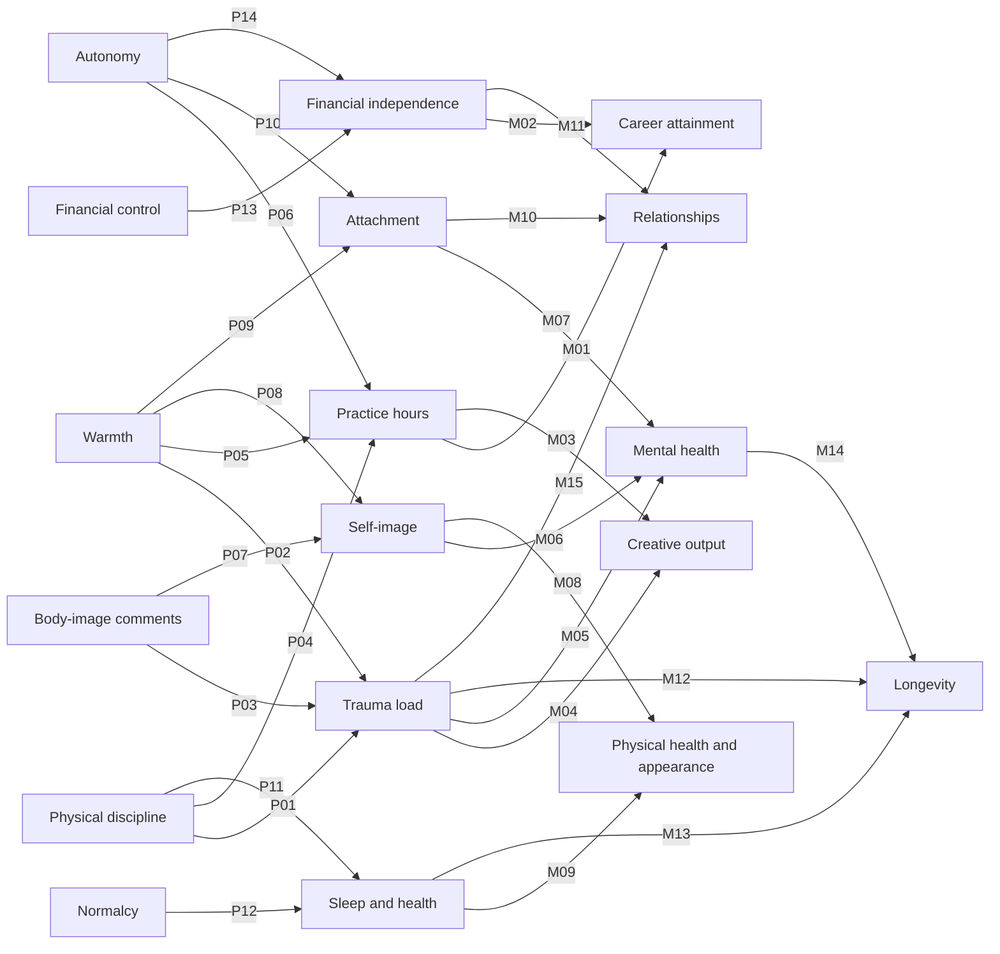

# Mechanism map

How the model moves from parenting dials to outcomes: six dials drive six mediators, and the mediators drive six outcome dimensions. Every arrow carries the `link_id` of its row in `data/parameters.csv`: 29 arrows, 29 rows. Each row holds a low/high range and a basis label (RESEARCH, SIBLING CALIBRATION or ASSUMPTION).

This is a scenario model, not a prediction. The arrows say which way an effect is assumed to run and roughly how large it is, under stated assumptions.

## Basis labels at a glance

| Basis | Links | Count |
|---|---|---|
| RESEARCH | P01, P11, M05, M09, M13, M14 | 6 |
| SIBLING CALIBRATION | P04, P13, P14, M01, M12 | 5 |
| ASSUMPTION | P02, P03, P05, P06, P07, P08, P09, P10, P12, M02, M03, M04, M06, M07, M08, M10, M11, M15 | 18 |

Most links are ASSUMPTION, and that's stated plainly. Six of them (P02, P07, P09, M06, M07, M10) were relabeled from RESEARCH on 2026-11-20, because no source for them was read. `docs/research_anchors.md` lists what backs each RESEARCH link.

## Sign convention

- **Dials** run 0 to 10. The engine divides by 10 before applying coefficients.
- **Mediators** run 0 to 10 and are clipped. Five are **loads**, where higher means heavier: Trauma / fear load, Self-image & body perception, Attachment & trust in adults (higher = more distrust), Sleep & physical health (higher = worse), and Financial independence timing (higher = later independence). Practice hours & skill acquisition is a **level**, where higher means more skill-building.
- **Warmth reduces loads.** Its coefficients (P02, P08, P09) are negative, and so are P10, P12 and P14.
- **Outcomes** run 0 to 10, where higher means a better outcome. Each starts at a baseline drawn per run (6.0-8.0; Longevity 4.5-9.5, centered on 7.0, ASSUMPTION, since Step 3.6) that stands for everything outside the parenting variable. 7.0 is the reference midpoint: an ordinary lifespan for a US man born in 1958 (life expectancy 66.6, CDC/NCHS). A positive coefficient on a load-to-outcome link is applied as a subtraction, and practice is applied as an addition around a midpoint of 5.
- **M04 crosses zero** (-0.10 to 0.25) on purpose. Pain fed some of the art and suppressed some of it, and the range carries that uncertainty instead of picking a side.
- **M14 starts from an outcome, not a mediator.** Mental health feeds Longevity as a load: `mental baseline - mental` for that run.

- **Every load-to-outcome link is positive and subtracted.** M02 used to be the exception: its range was -0.25 to -0.05, so subtracting it meant a later financial independence *raised* career attainment. On 2026-11-20 its range was flipped to 0.05 to 0.25 and the subtraction kept, so a heavier delay load lowers career like every other load. M04 is the only load-to-outcome range that still crosses zero, on purpose.

## Fixed numbers that aren't links

These go into the assumptions register (dashboard page 3) next to the 29 links.

| Number | Where | Basis |
|---|---|---|
| Outcome baseline per run: 6.0-8.0 (Longevity 4.5-9.5, centered on 7.0); 7.0 reference | every outcome | ASSUMPTION (Step 3.6, option E) |
| 0.25 practice intercept | Practice hours | ASSUMPTION |
| 0.55 attachment intercept | Attachment & trust | ASSUMPTION |
| Logistic midpoint 5.5, scale 1.2 | career branch (fame likelihood) | ASSUMPTION |
| Branch C share clipped to 0.15-0.90 | career branch | ASSUMPTION |
| Stage decay 0 / 0.1 / 0.2 / 0.35 / 0.5 | Mental and Physical health by life stage | ASSUMPTION |
| Longevity bins 0-2 / 2-3.5 / 3.5-5 / 5+ = <45 / 45-55 / 55-65 / 65+ (Step 3.6; was 0-3 / 3-5 / 5-7 / 7+) | longevity bands | ASSUMPTION |

## The branch interaction

Lowering discipline lowers practice hours through P04, which shifts probability toward Branch A (no professional career). That shift isn't automatic, though. In runs where the warmth and autonomy coefficients (P05, P06) draw high, practice holds up anyway, and intrinsic motivation replaces fear. So the model can show the "firm but nurturing" preset reaching a career without the trauma load, but only as a band of runs, and only to the extent P05 and P06 allow. Both are ASSUMPTION, so this is the part of the model to read most carefully.

## Consistency with the other tables

- Every `from_node` and `to_node` in `parameters.csv` matches a name in `dials.csv`, `mediators.csv` or `outcome_dimensions.csv` (re-checked 2026-11-20 after the M02, P14, dial and mediator fixes).
- Every mediator's drivers in `mediators.csv` match the P-links exactly.
- Every mediator's `feeds_outcomes` in `mediators.csv` matches its M-links exactly, using the full names from `outcome_dimensions.csv`. Trauma → Creative output (M04) was added on 2026-11-20.
